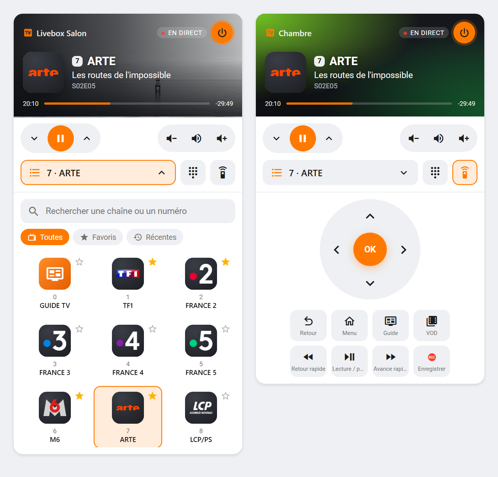
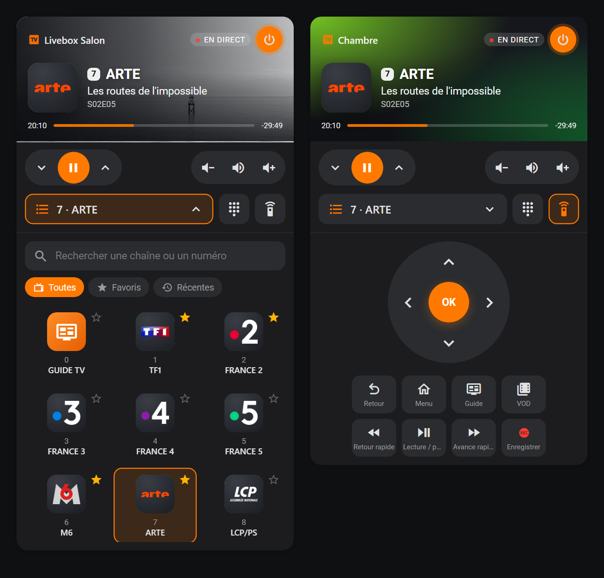
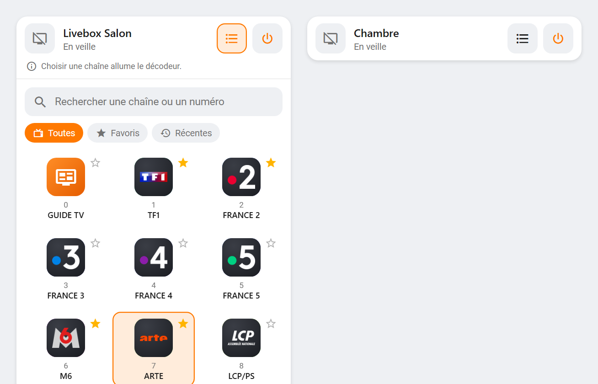
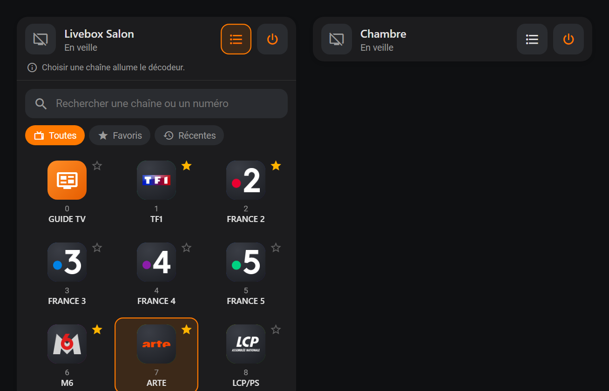

# Livebox TV Card

[](https://hacs.xyz/docs/faq/custom_repositories/)
[](https://github.com/aubierr/ha-livebox-card/actions/workflows/validate.yml)

[](https://my.home-assistant.io/redirect/hacs_repository/?owner=aubierr&repository=ha-livebox-card&category=plugin)

| Thème clair | Thème sombre |
| --- | --- |
|  |  |

**[▶ Essayer la démo en ligne](https://aubierr.github.io/ha-livebox-card/test/)** (décodeur simulé, aucune installation nécessaire)

Carte Lovelace pour Home Assistant qui pilote le **décodeur TV UHD Orange** via l'intégration
[liveboxtvuhd](https://github.com/AkA57/liveboxtvuhd).

- En-tête avec le **programme en cours** (visuel EPG, titre, saison/épisode, barre de progression en direct)
- **Changement de chaîne** depuis une liste recherchable (grille ou liste), avec **favoris** et **chaînes récentes**
- Contrôles : marche/arrêt, chaîne +/−, lecture/pause, volume +/−, muet
- **Télécommande** intégrée (croix directionnelle, OK, retour, menu, guide, VOD, retour/avance rapide, enregistrement)
- **Pavé numérique** : tapez `6` → M6, la chaîne est reconnue et sélectionnée automatiquement
- Mise à jour optimiste : la chaîne choisie s'affiche tout de suite, puis l'entité est rafraîchie (l'intégration n'interroge le décodeur que toutes les 30 s)
- **Mode veille compact** : décodeur éteint, la carte se réduit à une ligne ; choisir une chaîne l'allume puis zappe dessus
- Éditeur visuel, thèmes clair/sombre

## Installation

Nécessite Home Assistant 2024.11 ou plus récent et l'intégration liveboxtvuhd.

### HACS (dépôt personnalisé)
Le plus simple : cliquez sur ce bouton, il ouvre la carte directement dans le HACS de votre Home Assistant.

[](https://my.home-assistant.io/redirect/hacs_repository/?owner=aubierr&repository=ha-livebox-card&category=plugin)

Ou à la main :
1. HACS → ⋮ → *Dépôts personnalisés* → ajoutez `https://github.com/aubierr/ha-livebox-card`, catégorie **Dashboard**
   ([aide HACS sur les dépôts personnalisés](https://hacs.xyz/docs/faq/custom_repositories/)).
2. Installez **Livebox TV Card**, puis rechargez le navigateur.

HACS n'est pas encore installé ? Suivez le [guide d'installation de HACS](https://hacs.xyz/docs/use/).

### Manuelle
1. Copiez le contenu du dossier [`dist/`](dist) (le fichier `livebox-tv-card.js` **et le dossier `logos/`**) dans `config/www/` :
   ```
   config/www/livebox-tv-card.js
   config/www/logos/tf1-fr.png …
   ```
2. *Paramètres → Tableaux de bord → ⋮ → Ressources* → ajoutez `/local/livebox-tv-card.js` (type **Module JavaScript**).
3. Rechargez le navigateur (Ctrl+F5).

La carte cherche les logos dans le dossier `logos/` situé à côté du fichier `.js`. S'ils n'y sont pas
(par exemple si HACS n'a installé que le fichier `.js`), elle les charge automatiquement depuis Internet.
Pour les ranger ailleurs, utilisez `logo_path`, par ex. `logo_path: /local/livebox-logos/`.

## Configuration

Minimale :

```yaml
type: custom:livebox-tv-card
entity: media_player.livebox_salon
```

Complète :

```yaml
type: custom:livebox-tv-card
entity: media_player.livebox_salon
remote_entity: remote.livebox_salon   # auto-détectée (même appareil) si absente
name: Salon
default_panel: none                   # none | channels | remote | keypad
channel_layout: grid                  # grid | list
list_height: 340
show_artwork: true
show_progress: true
show_volume: true
show_remote: true
show_keypad: true
hide_guide: false                     # masque « 0. GUIDE TV »
close_on_select: true
power_on_delay: 6                     # secondes entre l'allumage et le zapping (chaîne choisie en veille)
builtin_logos: true                   # logos réels des chaînes
favorites: [1, 2, 3, 5, 6, "ARTE"]    # favoris initiaux (numéro ou nom)
logo_path: /local/logos/              # dossier des logos intégrés (défaut : logos/ à côté de la carte)
logo_template: "/local/mes-logos/{slug}.png"
logos:
  MIEUX: /local/mes-logos/mieux.png
  "6": /local/mes-logos/m6.png
```

| Option | Défaut | Description |
| --- | --- | --- |
| `entity` | **obligatoire** | Le `media_player` de l'intégration liveboxtvuhd |
| `remote_entity` | auto | L'entité `remote` du décodeur (télécommande et pavé numérique) |
| `name` | nom de l'entité | Titre affiché |
| `default_panel` | `none` | Panneau ouvert au chargement |
| `channel_layout` | `grid` | Affichage des chaînes en grille de logos ou en liste |
| `list_height` | `340` | Hauteur max. (px) de la liste des chaînes |
| `show_artwork` | `true` | Visuel du programme en fond d'en-tête |
| `show_progress` | `true` | Barre de progression du programme |
| `show_volume` | `true` | Boutons volume / muet |
| `show_remote` | `true` | Bouton télécommande |
| `show_keypad` | `true` | Bouton pavé numérique |
| `hide_guide` | `false` | Masquer l'entrée « GUIDE TV » |
| `close_on_select` | `true` | Fermer la liste après avoir choisi une chaîne |
| `power_on_delay` | `6` | Secondes d'attente entre l'allumage et le changement de chaîne, quand on choisit une chaîne en veille |
| `builtin_logos` | `true` | Utiliser les logos intégrés |
| `logo_path` | `logos/` à côté de la carte | Dossier contenant les logos intégrés |
| `favorites` | `[]` | Favoris initiaux (numéros ou noms) |
| `logos` | `{}` | Logos par nom, numéro ou source (`"1. TF1"`) |
| `logo_template` | – | Modèle d'URL : `{slug}` (`france-2`, `canal-plus`), `{name}`, `{number}` |

### Logos des chaînes
La carte intègre les **vrais logos** des chaînes, stockés **en local** dans le dossier
[`dist/logos/`](dist/logos) (226 fichiers, 3,5 Mo, 256 px max) :

| Liste de l'intégration | Chaînes | Avec logo | Sans logo |
| --- | --- | --- | --- |
| France (par défaut) | 247 | **247** | — (« GUIDE TV » affiche l'icône du guide) |
| Caraïbes | 187 | 183 | ATV, Nina Novelas, Tfou Max, Cheval TV |
| Pologne | 210 | 4 | non prise en charge pour l'instant |

Sources : le dépôt libre [tv-logo/tv-logos](https://github.com/tv-logo/tv-logos) (168 fichiers), la base
[iptv-org](https://github.com/iptv-org/database) (56 fichiers : imgur, Wikimedia, sites des chaînes),
[picons](https://github.com/picons/picons) (Trace Tropical) et [france.tv](https://www.france.tv/) (Mieux).
Le détail fichier par fichier est dans [`dist/logos/CREDITS.md`](dist/logos/CREDITS.md).

Plusieurs chaînes partagent un fichier (les décrochages régionaux utilisent le logo France 3, Marmite TV celui de
Marmiton TV, Gulli Max celui de Gulli…). Les logos trop sombres sont affichés sur fond clair. Les chaînes sans logo
gardent un badge coloré.

Ordre de priorité : `logos` → `logo_template` → logo local → même logo en ligne → badge.
Pour vos propres images, déposez-les par ex. dans `config/www/mes-logos/` et utilisez
`logo_template: /local/mes-logos/{slug}.png` ou `logos:` pour quelques chaînes.
`builtin_logos: false` désactive les logos intégrés.

Pour retélécharger les logos (après modification de la table `CHANNEL_LOGOS` de la carte) :
`python tools/fetch_logos.py .` (nécessite Pillow). `test/logos.html` affiche la planche des logos en ligne.

### Mode veille
Quand le décodeur est éteint, la carte se réduit à une seule ligne : nom, état, boutons **Chaînes**
et **marche**. Choisir une chaîne dans la liste allume le décodeur, attend `power_on_delay` secondes qu'il
démarre, puis zappe dessus. Si votre décodeur met plus de temps à démarrer, augmentez ce délai.

| Thème clair | Thème sombre |
| --- | --- |
|  |  |

### Favoris et récentes
Touchez l'étoile d'une chaîne pour l'ajouter aux favoris. Favoris et récentes sont mémorisés dans le navigateur
(par appareil). La liste `favorites` de la configuration sert de point de départ tant qu'aucun favori n'a été modifié.

## Astuces
- Dans la recherche, **Entrée** sélectionne le premier résultat ; tapez un numéro (`40`) ou un nom (`canal`).
- Le pavé numérique valide tout seul après 2 s. Si le numéro n'est pas dans la liste, les chiffres sont envoyés à la télécommande.
- Le bouton d'alimentation envoie `turn_on` si le décodeur est éteint et `turn_off` sinon (la touche POWER de la box est une bascule).

## Licence
Le code est distribué sous licence [MIT](LICENSE).
Les logos de [`dist/logos/`](dist/logos) n'en font pas partie : ce sont des marques déposées appartenant à leurs
détenteurs, fournies pour un usage personnel et non commercial. Leurs sources sont listées dans
[`dist/logos/CREDITS.md`](dist/logos/CREDITS.md).
